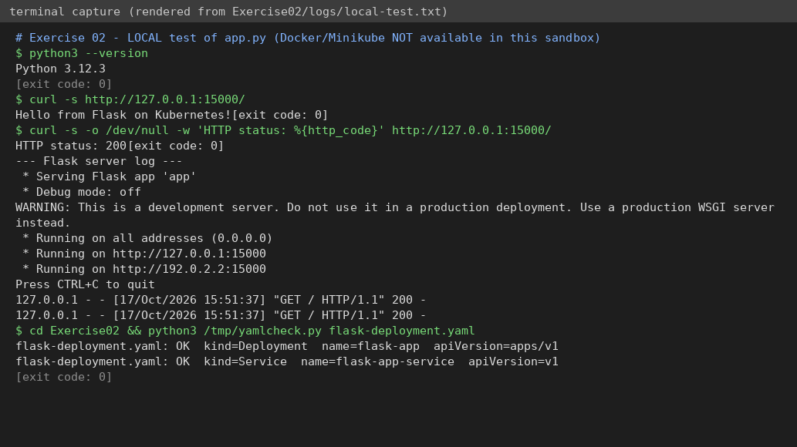

# Exercise 2 – Deploy a Flask app on Minikube using kubectl and YAML

**Status: 🟡 PARTIAL.** The Flask app and the YAML were tested; the Docker build and the Kubernetes deployment were **NOT run** (no Docker/Minikube available).

## Question (original text in [`QUESTION.md`](QUESTION.md))
Start Minikube → write `app.py` (Flask, port 15000) → write a `Dockerfile` → build the image inside Minikube's Docker (`eval $(minikube docker-env)`) → write `flask-deployment.yaml` (`imagePullPolicy: Never`) → `kubectl apply` → check deployment/pods/logs → see that `curl 127.0.0.1:15000` fails → add a NodePort **Service** (15000→15000) → `minikube service flask-app-service --url` → curl it. Then answer the 10 Q&As.

## Files
`app.py`, `Dockerfile`, `flask-deployment.yaml` (Deployment + Service), `run.sh`.

## How to run (machine with Minikube)
```bash
bash run.sh
curl <URL printed by "minikube service flask-app-service --url">    # 2nd terminal
```

## Simple explanation
* Flask listens on `0.0.0.0:15000` (0.0.0.0 = reachable from outside the container).
* `eval $(minikube docker-env)` points my Docker CLI to Minikube's Docker, so the image already exists inside the cluster – hence `imagePullPolicy: Never` (don't look on Docker Hub).
* The **Deployment** keeps the Pod running; the **Service** gives a stable address. `port` = Service port, `targetPort` = container port.
* curl to 127.0.0.1:15000 fails first because Minikube has its own network and nothing exposes the Pod.

## Verification
| Check | Result |
|---|---|
| `python3 app.py` then `curl http://127.0.0.1:15000/` → `Hello from Flask on Kubernetes!`, HTTP 200 | ✅ really run – [`logs/local-test.txt`](logs/local-test.txt) |
| `flask-deployment.yaml` parses; Deployment + Service present | ✅ syntax only |
| `docker build`, `kubectl apply`, pods Running, service URL | ⛔ **not run** |


*(rendered from the real log file – not a GUI screenshot)*

## Q&A
1. Purpose of `minikube service flask-app-service --url`? Prints a URL to reach the service.
2. What happens? Minikube checks the service, creates a tunnel/URL and prints it.
3. Why `targetPort`? It names the port the container really listens on.
4. port vs targetPort? port = Service's port; targetPort = container's port.
5. Access Flask in Minikube? `minikube service <name> --url` then curl/browser.
6. Why keep the terminal open? With the Docker driver on Linux the URL is a local tunnel that lives only while the command runs.
7. Benefit of `--url`? No need to work out node IP + node port by hand.
8. Command to expose a service? `kubectl expose` or `kubectl apply -f service.yaml`.
9. How does Minikube help? A single-node local cluster for testing.
10. Role of kubectl? CLI to talk to the Kubernetes API (deploy, scale, inspect, delete).

## To finish (needs you)
`bash run.sh`; screenshots: `01-deployment-pods.png`, `02-describe-or-logs.png`, `03-service-url-curl.png`.
