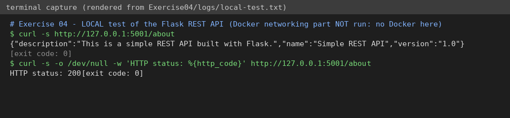

# Exercise 4 – Docker networking with multiple containers

**Status: 🟡 PARTIAL.** The Flask API was run and tested locally; **all Docker network/container steps were NOT run** (no Docker available).

## Question (original text in [`QUESTION.md`](QUESTION.md))
Create a user-defined **bridge network**, list and inspect it, build a Flask API image, run **MySQL, Redis and Flask** containers on it, test connectivity by container name, clean up, and answer 4 questions.

## Files
`app.py`, `requirements.txt`, `Dockerfile`, `run.sh` (all commands incl. cleanup).

## How to run (needs Docker)
```bash
bash run.sh
```

## Changes to the manual (expected to fail otherwise – not confirmed without Docker)
1. `mysql:latest` exits at start without a root password → added `-e MYSQL_ROOT_PASSWORD=devops123`.
2. `python:3.9-slim` has no `ping` → connectivity is tested with Python (`socket.gethostbyname`, TCP connect to `redis:6379`).
3. `Flask==2.0.1` with a recent Werkzeug fails to import → pinned `Werkzeug==2.0.3`.
4. App bound to 127.0.0.1 → `-p 5001:5001` would not reach it; now `host='0.0.0.0'`, `debug=False`.

## Simple explanation
On a **user-defined bridge** Docker provides DNS, so containers reach each other by **name** (`mysql`, `redis`). `--net` chooses the network; `-p host:container` publishes a port to the host.

## Verification
| Check | Result |
|---|---|
| `curl http://127.0.0.1:5001/about` → JSON, HTTP 200 | ✅ really run – [`logs/local-test.txt`](logs/local-test.txt) |
| network create/ls/inspect, image build, 3 containers, name resolution, cleanup | ⛔ **not run** |



## Answers
1. `--net` selects the network the container joins. 2. By container name (Docker DNS) or IP on the same network. 3. Bridge = private virtual network with isolation (publish ports with `-p`); host = container shares the host network stack, no isolation. 4. `-p <hostport>:<containerport>`, e.g. `-p 5001:5001`.

## To finish (needs you)
`bash run.sh`; screenshots: `01-network-ls-inspect.png`, `02-containers-running.png`, `03-name-resolution.png`, `04-curl-about.png`.
