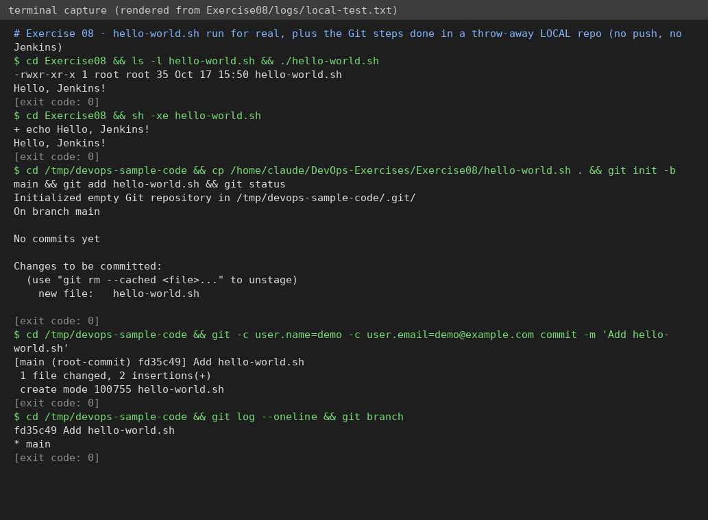

# Exercise 8 – "Hello World" Jenkins job

**Status: 🟡 PARTIAL.** The script and the local Git workflow were really executed; GitHub push and the Jenkins job were **NOT done**.

## Question (original text in [`QUESTION.md`](QUESTION.md))
Create `hello-world.sh`, put it in a new public GitHub repo `devops-sample-code` using the terminal (init, add, status, commit, remote, push with a personal access token), then in Jenkins create a **Freestyle project** `HelloWorld` (Git SCM, Execute shell `sh hello-world.sh`), run **Build Now** and view the **Console Output**.

## Files
`hello-world.sh` (prints `Hello, Jenkins!`).

## Commands
```bash
# 1. script
chmod +x hello-world.sh && ./hello-world.sh
# 2. git (in the folder that will become the repo devops-sample-code)
git init -b main                      # -b main: the manual's "git push -u origin main" fails if the branch is called master
git config user.name  "<your name>"
git config user.email "<your email>"
git add hello-world.sh && git status
git commit -m "Add hello-world.sh"
git remote add origin https://github.com/AyushiPachauri54/devops-sample-code.git
git push -u origin main               # username + fine-grained PAT when prompted (never share the token)
# 3. Jenkins: New Item → HelloWorld → Freestyle → SCM Git (repo URL, branch */main) → Build → Execute shell: sh hello-world.sh → Save → Build Now → Console Output
```
Expected console output ends with `Hello, Jenkins!` and `Finished: SUCCESS`.

## Simple explanation
Jenkins checks the repo out into its *workspace*, then runs the shell step there. The job succeeds when the shell exits with code 0.

## Verification
| Check | Result |
|---|---|
| `./hello-world.sh` prints `Hello, Jenkins!` | ✅ really run – [`logs/local-test.txt`](logs/local-test.txt) |
| `git init / add / status / commit / log` in a throw-away local repo | ✅ really run (same log) – demo identity only, nothing pushed |
| Push to `devops-sample-code`, Jenkins job, console output | ⛔ **not done** |



## To finish (needs you)
Create the repo and Jenkins job yourself; screenshots: `01-git-push.png`, `02-github-file.png`, `03-jenkins-config.png`, `04-console-output.png`.
