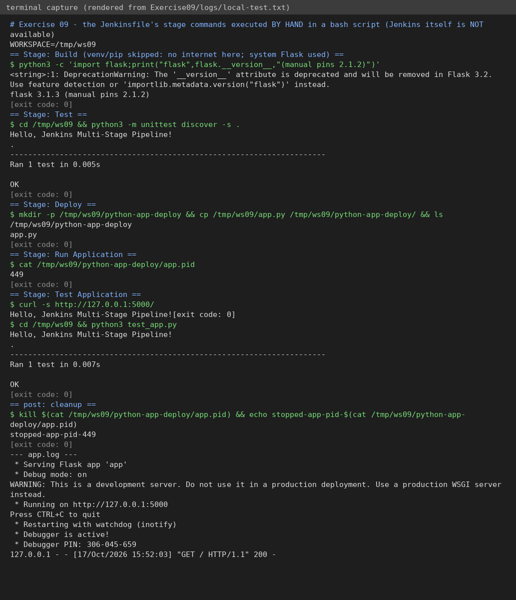

# Exercise 9 – Jenkins multi-stage pipeline (Python app)

**Status: 🟡 PARTIAL.** The unit test, deploy copy and app run were executed **by hand** following the Jenkinsfile's stages; the Jenkinsfile itself was **NOT run in Jenkins**.

## Question (original text in [`QUESTION.md`](QUESTION.md))
Create a Flask app with `requirements.txt` and `test_app.py`, push it to GitHub, create a Jenkins **Pipeline** job (*Pipeline script from SCM*) with stages **Build → Test → Deploy (→ Run Application → Test Application)**, fix missing python3/pip in the Jenkins container, run it and read the console output.

## Files (`python-flask-app/`)
`app.py`, `requirements.txt` (`flask==2.1.2`), `test_app.py`, `Jenkinsfile`.

## How to run
1. Push `python-flask-app/` contents to your GitHub repo (repo root must contain the Jenkinsfile).
2. Jenkins container needs Python: `docker exec -it -u root jenkins bash -c "apt-get update && apt-get install -y python3 python3-pip python3-venv curl"`.
3. Jenkins → New Item → `Python-MultiStage-Pipeline` → Pipeline → *Pipeline script from SCM* → Git URL → Build Now → Console Output.

## Changes to the manual's Jenkinsfile
* **Build** stage now really creates a venv and installs `requirements.txt` (the manual only echoed text although the explanation says it installs dependencies).
* Uses the venv's Python so Debian's "externally-managed-environment" pip error is avoided and no `apt install python3-flask` is needed.
* **Run Application** uses `JENKINS_NODE_COOKIE=dontKillMe` (otherwise Jenkins kills background processes when the stage ends) and **Test Application** waits and `curl`s the running app (the manual re-ran the unit test only). A `post { always }` block stops the app so port 5000 isn't left busy.
* `app.py` uses `debug=True` as in the manual; the debug reloader starts a second process – fine for a lab, not for production.
* Flask version: the manual pins 2.1.2, which needs an older Werkzeug (`pip` normally picks a compatible one; if the venv install fails with an import error, add `Werkzeug<3` to requirements).

## Simple explanation
A **pipeline** is code (Groovy `Jenkinsfile`) describing stages. Jenkins runs them in order and stops at the first failing stage. Build installs deps, Test runs unit tests, Deploy copies the app to a deploy folder, then it is started and smoke-tested.

## Verification
| Check | Result |
|---|---|
| `python3 -m unittest discover` → 1 test OK | ✅ really run (Flask 3.1.3 installed here, **not** the 2.1.2 pin) |
| Deploy copy, start app, `curl /` → `Hello, Jenkins Multi-Stage Pipeline!`, rerun test | ✅ really run, manually – [`logs/local-test.txt`](logs/local-test.txt) |
| venv + `pip install` (no internet here) | ⛔ not run |
| Jenkinsfile syntax check / pipeline run in Jenkins | ⛔ **not run** |

## To finish (needs you)
Run the pipeline in Jenkins; screenshots: `01-stage-view.png`, `02-console-output.png`.
