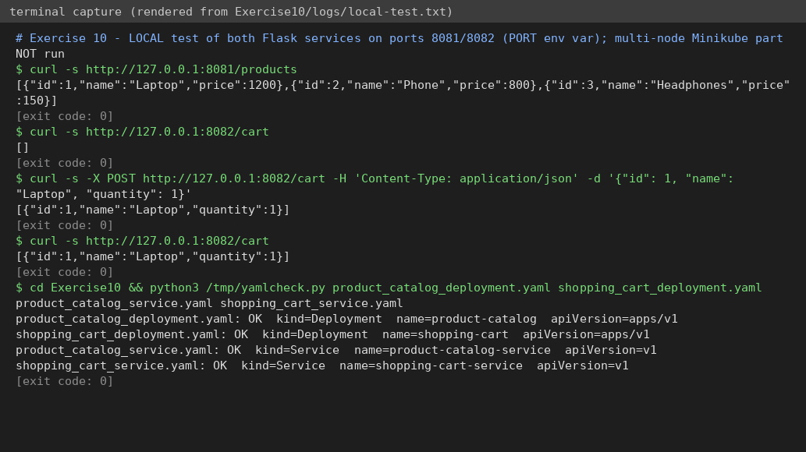

# Exercise 10 – Multi-node Minikube, multiple apps with replicas

**Status: 🟡 PARTIAL.** Both Flask services were run and tested locally and the YAML parses; the multi-node cluster, images, Deployments and pod spreading were **NOT run**.

## Question (original text in [`QUESTION.md`](QUESTION.md))
E-commerce platform with **Product Catalog (2 replicas)** and **Shopping Cart (3 replicas)** on a **3-node Minikube** cluster (`-p devops-multinode`), replicas spread across different nodes (pod anti-affinity), images loaded into the cluster, NodePort services, verify with `kubectl get pods -o wide`, test with `curl`.

## Files
`product_catalog.py`, `shopping_cart.py`, `Dockerfile.product`, `Dockerfile.shopping`, `product_catalog_deployment.yaml`, `shopping_cart_deployment.yaml`, `product_catalog_service.yaml`, `shopping_cart_service.yaml`, `run.sh`.

## How to run (Docker + Minikube; ≈ 6 GB RAM free)
```bash
bash run.sh
```

## Changes to the manual
1. `shopping_cart_deployment.yaml` used `namespace: devops-exercise` which is never created (apply fails) while its Service is in `default` → both use `default`.
2. Apps read an optional `PORT` env var (default **80**, unchanged in the containers) only so I could test without root.
3. `--force` (needed for root + Docker driver) kept as in the manual.
4. `minikube image load` is used (the registry add-on in step 1b is not needed for it) – `imagePullPolicy: Never` then works on every node.

## Simple explanation
`replicas: 2/3` makes a ReplicaSet behind each Deployment. `podAntiAffinity` with `requiredDuringScheduling…` and `topologyKey: kubernetes.io/hostname` says "never place two pods of this app on the same node", so losing a node cannot take the whole service down. With 3 nodes, the 3 cart pods take one node each; if a node were missing, the 3rd pod would stay *Pending*. The NodePort Service load-balances to all pods of the label.
*Caveat:* the cart keeps data in a Python list in each pod's memory, so with 3 replicas a GET may hit a pod that did not receive your POST – a good point to mention in the viva (real systems use Redis/DB).

## Verification
| Check | Result |
|---|---|
| Catalog `/products` returns 3 products | ✅ really run – [`logs/local-test.txt`](logs/local-test.txt) |
| Cart `GET /cart` → `[]`, `POST /cart`, `GET /cart` returns the item | ✅ really run (single process) |
| 4 manifests parse | ✅ syntax only |
| 3-node cluster, image load, 2+3 pods on different nodes, NodePort access | ⛔ **not run** |



## To finish (needs you)
`bash run.sh`; screenshots: `01-nodes.png`, `02-pods-wide.png`, `03-curl-products.png`, `04-curl-cart.png`.
